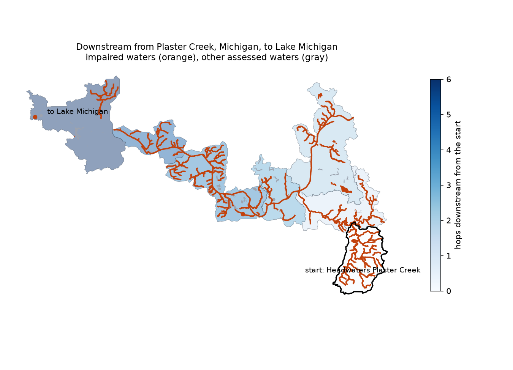

# attains-trace

[](https://github.com/drmerlot/attains-trace/actions/workflows/tests.yml)

Start from any US watershed (HUC12), walk the network downstream to the outlet or upstream through its tributaries,
and list the assessed waters along the way: which are impaired, for what, and whether a cleanup plan (TMDL) covers
each cause. A first screen for any site question that starts with "what does this drain to?".

- Reads the **USGS Watershed Boundary Dataset** (HUC12s and their downstream neighbors) and **EPA ATTAINS** (state
  assessment units, EPA's national unit-to-HUC12 crosswalk, and the parameters behind each listing).
- Returns **pandas / geopandas** tables and GeoDataFrames; a command line writes GeoJSON.
- Mirrors a region into **PostGIS** and runs the same traces as recursive SQL, with GiST-indexed point lookup.



## Command line

```console
$ attains-trace 040500060505 --cache .cache
downstream from 040500060505: 7 HUC12s, 45 assessed waters, 31 impaired
 hops        huc12                        name
    0 040500060505    Headwaters Plaster Creek
    1 040500060506               Plaster Creek
    2 040500060507 Lamberton Creek-Grand River
    3 040500060512  Town of Walker-Grand River
    4 040500060705    Ottawa Creek-Grand River
    5 040500060708      Jubb Bayou-Grand River
    6 040500060712     Lloyd Bayou-Grand River

impairment causes (units listing it, units with a TMDL for it, nearest hop):
                        parametergroupname  units  with_tmdl  nearest_hop
          POLYCHLORINATED BIPHENYLS (PCBS)     27         26            0
PER- AND POLYFLUOROALKYL SUBSTANCES (PFAS)     24          0            0
                                   MERCURY     23         20            0
                                 PATHOGENS     19         19            0
                             CAUSE UNKNOWN      5          0            0
                                  SEDIMENT      5          4            0
                                       ...
```

`--upstream` traces everything draining to the HUC12 (capped by `--max-hops` and `--max-units`), `--geojson PREFIX`
writes the HUC12 polygons and the assessment-unit geometries, and `--postgis DSN` runs against a PostGIS mirror.

## Python

```python
from attains_trace import ServiceNetwork, trace

net = ServiceNetwork(cache_dir=".cache")
t = trace("040500060505", "downstream", net)
t.path              # HUC12s in order, with hops from the start
t.impaired          # impaired assessment units, nearest first, with EPA's links to each waterbody report
t.cause_summary()   # each cause: units listing it, units with a TMDL for it (category 4A), nearest hop
huc12s, waters = t.to_geodataframes(net)     # geopandas, EPSG:4326
```

The tracer only needs `records(codes)`, `upstream(codes)`, `assessments(codes)` and `parameters(ids)` from a network,
so the same code runs against the live services, the PostGIS mirror, or a test fake.

## PostGIS mirror

```python
from attains_trace import postgis, trace

conn = postgis.connect("postgresql://...")
postgis.load_region(conn, "040500")          # every HUC12 starting 040500, with boundaries, assessments and causes
postgis.trace_downstream_sql(conn, "040500060505")       # one WITH RECURSIVE query over huc12.tohuc
postgis.trace_upstream_sql(conn, "040500060512")
postgis.huc12_at(conn, -85.58, 42.85)        # which HUC12 is this site in? (ST_Intersects on the GiST index)
trace("040500060505", "downstream", postgis.PostgisNetwork(conn))
```

The schema keeps the network in `huc12` (primary key on the code, B-tree on `tohuc` for upstream joins, GiST on the
boundary), the crosswalk in `assessment` (keyed on HUC12 and unit) and causes in `parameter`. Loading upserts and
runs `ANALYZE`. Mirroring the Grand River basin (HUC6 040500) takes 467 HUC12s, 2,919 assessments and 5,515
parameter rows; the recursive SQL trace matches the live-service trace exactly, and `EXPLAIN ANALYZE` shows the
point lookup as an index scan on `huc12_geom_idx`.

## How it decides what is "along the way"

- **Network:** each HUC12's `tohuc` in the Watershed Boundary Dataset. Downstream stops at an ocean, closed basin,
  border or Great Lake code, or a code the service does not return. Upstream is breadth-first by hops.
- **Waters:** EPA's assessment-unit-to-HUC12 crosswalk (ATTAINS "Assessments by HUC12"), latest cycle per unit.
  This also resolves units whose IDs embed HUC12 codes that the USGS has since recoded.
- **Causes:** ATTAINS parameters with status "Cause". A cause counts as covered by a TMDL when its parameter category
  is 4A.

## Limitations

- HUC12 resolution: every assessed water in a traced HUC12 is listed, including side tributaries that the main flow
  path does not pass through.
- A unit can be crosswalked to more than one HUC12, and some units are large (a Great Lakes shoreline segment), so
  maps clip them to the traced HUC12s.
- Listings are whatever each state last submitted to ATTAINS; cycles differ by state.
- Upstream traces on large rivers grow quickly; the caps keep them bounded and the result says when it was cut off.
- This is a screening tool, not a load allocation or a TMDL analysis.

## Tests

```bash
pip install -e ".[test]"
pytest                                        # tracing logic on a synthetic network
ATTAINS_TRACE_PG=postgresql://... pytest      # adds the PostGIS tests (in a throwaway schema)
ATTAINS_TRACE_LIVE=1 pytest                   # adds a trace against the live services
```

CI runs the PostGIS tests against a `postgis/postgis` service container on Python 3.10–3.12.

## Data sources

- U.S. Geological Survey, Watershed Boundary Dataset, HUC12 layer, via The National Map REST services.
- U.S. EPA, ATTAINS geospatial services (assessment units, assessments by HUC12, parameters).

## License

BSD-3-Clause.
